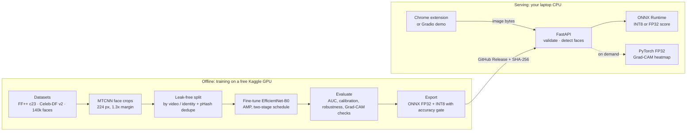
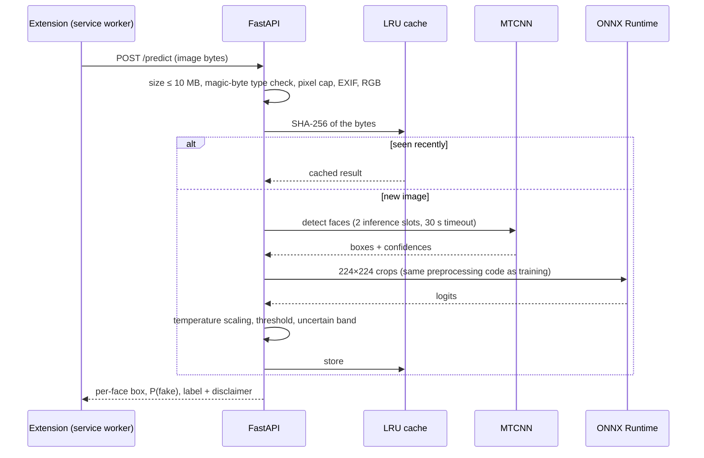
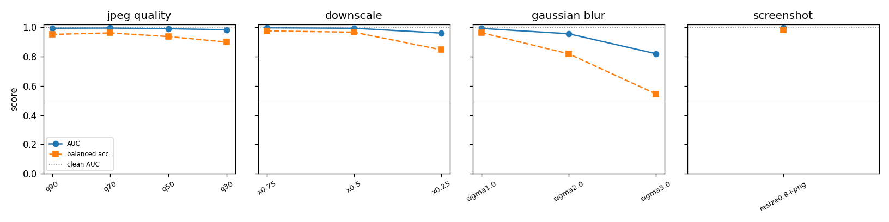
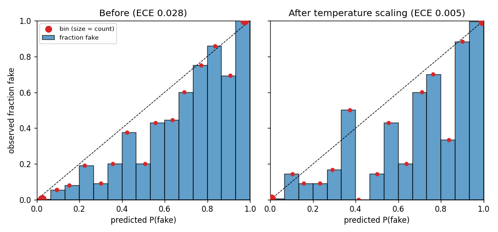

<div align="center">

# DeepTrace

**Finds the faces in a photo, estimates how likely each one is a deepfake, and shows which regions drove the call.**

[](https://github.com/Aditya-7826/deeptrace/actions/workflows/ci.yml)
[](https://www.python.org/)
[](LICENSE)
[](https://huggingface.co/spaces/Aditya-7826/deeptrace)

</div>

> [!NOTE]
> DeepTrace gives a **probabilistic estimate**, not proof. It can be wrong on generators it never saw, on heavily compressed images and on screenshots. Read [Limitations and ethics](#limitations-and-ethics) before relying on it.

## Contents

- [What is DeepTrace](#what-is-deeptrace)
- [Why it's needed](#why-its-needed)
- [How it works](#how-it-works)
- [Tech stack](#tech-stack)
- [Results](#results)
- [Run it on any laptop](#run-it-on-any-laptop-8-gb-ram-no-gpu-needed)
- [Train it yourself](#train-it-yourself)
- [Edge cases handled](#edge-cases-handled)
- [Limitations and ethics](#limitations-and-ethics)
- [Project structure](#project-structure)
- [License](#license)

## What is DeepTrace

DeepTrace looks at a photo, finds every face in it, and estimates the probability that each face was generated or swapped by AI. For any face it can also draw a Grad-CAM heatmap: a colour overlay showing which parts of the face pushed the model towards "fake" or "real". It runs on an ordinary laptop CPU through a small local API, a Chrome extension that scans the images on a page when you click its button, and a web demo.

## Why it's needed

Face-swap tools and diffusion models now produce convincing fake faces in seconds. They turn up in romance and investment scams, fake profiles, impersonation of public figures and misinformation, and most people can't tell them apart by eye.

A detector that only stamps "FAKE" is hard to trust: you can't see why it decided, or how sure it is. DeepTrace returns a **calibrated probability** (with an "uncertain" band rather than a forced yes/no) and a **heatmap** you can check yourself. If the heat sits on the background instead of the face, you know to doubt the answer.

## How it works



One `/predict` call:



<details>
<summary><b>What each component does</b></summary>

- **`deeptrace prepare`** finds faces with MTCNN and writes 224×224 crops and a `manifest.csv`. Real and fake images go through the identical decode → detect → crop → re-encode path, so file format can't give the label away. Splits keep each source video and identity in one split.
- **`deeptrace train`** fine-tunes a timm backbone (EfficientNet-B0 main; ResNet-50 and ViT-Small for comparison) from a YAML config. It checkpoints every epoch so a Kaggle session cut loses at most one epoch.
- **`deeptrace evaluate`** reports AUC with bootstrap confidence intervals, per-manipulation and cross-dataset results, robustness to compression and resizing, and calibration. The threshold and temperature are fitted on validation data only.
- **`deeptrace explain`** draws Grad-CAM heatmaps and runs two sanity checks: heatmaps must change when the weights are randomized, and most of the heat should land on the face, not the background or crop border.
- **`deeptrace export`** converts the model to ONNX, checks it matches PyTorch, and tries INT8 quantization. INT8 ships only if the AUC drops by at most 0.01; otherwise FP32 ONNX ships.
- **`deeptrace serve`** is the FastAPI service: `/health`, `/version`, `/predict` and `/explain?face_index=n`. It never fetches URLs, so it can't be used for SSRF.
- **The Chrome extension** (`extension/`) scans only when you click its toolbar button, fetches images in its service worker and draws a badge on each one. Clicking a badge opens the heatmap.
- **The Gradio demo** (`space/`) is the same engine as a web page for Hugging Face Spaces.

</details>

## Tech stack

| Layer | Tool | Why |
|---|---|---|
| Face detection | MTCNN (`facenet-pytorch`) | Accurate, gives confidences and landmarks, runs on CPU |
| Training | PyTorch, timm, `torch.amp` | Pretrained backbones and mixed precision on free T4 GPUs |
| Augmentation | Albumentations, OpenCV | JPEG, blur and resize augmentations that match real-world degradation |
| Evaluation | scikit-learn, matplotlib | Standard metrics, ROC, reliability and robustness plots |
| Explainability | pytorch-grad-cam | Grad-CAM for CNNs and ViTs (with CLS-token reshape) |
| Inference | ONNX Runtime (FP32; INT8 tried behind an accuracy gate) | Fast CPU scoring with a small memory footprint |
| API | FastAPI, uvicorn | Typed request handling, one worker fits in 8 GB RAM |
| Browser | Chrome extension, Manifest V3 | Scans on click only, no remote code, strict CSP |
| Demo | Gradio on Hugging Face Spaces | Free CPU hosting |
| Tooling | uv, pytest, ruff, Node test runner, GitHub Actions | Reproducible installs from `uv.lock` and CI without data or GPUs |
| Training compute | Kaggle Notebooks | Free GPU hours |

## Results

Every number below is generated from `results/*.json` by `scripts/update_readme_results.py`. Anything not measured yet says so.

<!-- results:start (generated by scripts/update_readme_results.py; do not edit) -->
### In-dataset vs cross-dataset AUC

| Run | Trained on | Test set | Kind | Test images | AUC [95% CI] | Accuracy | F1 |
|---|---|---|---|---|---|---|---|
| `effb0_kaggle140k` | 140k Real and Fake Faces (FFHQ vs StyleGAN) | 140k Real and Fake Faces (FFHQ vs StyleGAN) | in-dataset | 3998 | 0.999 [0.998, 0.999] | 0.987 | 0.987 |

- **Cross-dataset AUC (Celeb-DF v2): not yet measured.** It needs the FaceForensics++ and Celeb-DF runs, which wait on dataset access.

AUC is frame-level on held-out test splits; the 95% interval is a bootstrap. The decision threshold and the calibration temperature were fitted on validation only.

### Robustness

`effb0_kaggle140k` on 3998 140k Real and Fake Faces (FFHQ vs StyleGAN) test images. AUC after each perturbation:

| Perturbation | Levels (AUC) |
|---|---|
| JPEG quality | q90: 0.994, q70: 0.995, q50: 0.991, q30: 0.983 |
| Downscale | x0.75: 0.997, x0.5: 0.994, x0.25: 0.961 |
| Gaussian blur | sigma1.0: 0.993, sigma2.0: 0.956, sigma3.0: 0.820 |
| Screenshot (resize + PNG) | resize0.8+png: 0.998 |



### Calibration

`effb0_kaggle140k`: temperature 0.641, decision threshold 0.541, both fitted on 4000 validation images.

| | ECE before | ECE after temperature scaling |
|---|---|---|
| Validation | 0.026 | 0.004 |
| Test (in-dataset) | 0.028 | 0.005 |

Uncertain band 0.40–0.60: 0.4% of in-dataset test images.



### Architecture comparison

Not yet measured: needs the FaceForensics++ runs.

### Ablations

Not yet measured: needs the FaceForensics++ runs.

### CPU latency and memory

Measured on **AMD Ryzen 5 5600H with Radeon Graphics** (6 cores, 7.3 GB RAM, Windows-11-10.0.26200-SP0), batch 1, 4 threads, 200 runs after 20 warm-up. Model `effb0_kaggle140k-33515d1`.

| Model | Pipeline | p50 (ms) | p95 (ms) | Peak RSS (MB) |
|---|---|---|---|---|
| PyTorch FP32 | model only (224×224 crop) | 46.4 | 52.7 | 383 |
| ONNX FP32 | model only (224×224 crop) | 9.0 | 11.4 | 112 |
| PyTorch FP32 | end to end (detect + crop + score) | 209.5 | 271.3 | 417 |
| ONNX FP32 | end to end (detect + crop + score) | 170.3 | 203.0 | 428 |

No INT8 rows: the INT8 model was not shipped (see the export line below).

- **Export:** ONNX vs PyTorch max |Δlogit| 1.8e-05 on 100 images (tolerance 1e-04, passed). INT8 rejected by the accuracy gate (AUC drop > 0.01; the best of 4 attempts lost 0.20 AUC), so FP32 ONNX is served.
- **API memory:** peak RSS 703 MB across startup, sequential and concurrent `/predict` and the first `/explain` (within the 1500 MB budget), measured by `scripts/measure_api_memory.py`.

### Grad-CAM

- **Model-randomization test** (200 images): mean |Spearman| between real and randomized-weight heatmaps 0.24 (passed: maps depend on the learned weights).
- **Where the heat lands:** 78% face, 15% crop border, 7% background (mean over 200 test crops).

The example gallery is not committed: the 140k test images include real people (FFHQ photos from Flickr). Rebuild it locally with `deeptrace explain --run artifacts/runs/effb0_kaggle140k --data-root <crops> --gallery gallery.png`.
<!-- results:end -->

## Run it on any laptop (8 GB RAM, no GPU needed)

### 1. Prerequisites

You need **git** and **[uv](https://docs.astral.sh/uv/)** (uv installs the right Python by itself). Node.js 22+ is only needed to run the extension's tests.

| OS | Install command |
|---|---|
| Windows (PowerShell) | `winget install --id Git.Git -e` then `winget install --id astral-sh.uv -e` |
| macOS | `brew install git uv` |
| Linux | `sudo apt install git` (or your distro's equivalent) then `curl -LsSf https://astral.sh/uv/install.sh \| sh` |

### 2. Install, download the model, start the API

PowerShell:
```powershell
git clone https://github.com/Aditya-7826/deeptrace.git
cd deeptrace
uv sync
uv run python -m deeptrace download-weights
uv run python -m deeptrace serve
```

bash:
```bash
git clone https://github.com/Aditya-7826/deeptrace.git
cd deeptrace
uv sync
uv run python -m deeptrace download-weights
uv run python -m deeptrace serve
```

`download-weights` fetches the model files from the GitHub Release into `weights/` and checks their SHA-256 sums. The API then listens on http://127.0.0.1:8000 (this machine only). Check it with:

PowerShell:
```powershell
curl.exe -F "file=@tests/fixtures/images/real/aldrin.jpg" http://127.0.0.1:8000/predict
```

bash:
```bash
curl -F "file=@tests/fixtures/images/real/aldrin.jpg" http://127.0.0.1:8000/predict
```

<details>
<summary>Example response</summary>

```json
{
  "status": "ok",
  "faces": [
    {"index": 0, "box": [131.2, 118.5, 377.9, 431.0], "probability_fake": 0.0312, "label": "real", "...": "..."}
  ],
  "image_sha256": "…",
  "cached": false,
  "model_version": "…",
  "disclaimer": "probabilistic estimate; may be wrong on unseen generators, heavy compression or screenshots"
}
```
The numbers here are illustrative, not a measurement. Other statuses are `no_face` and `face_too_small`.
</details>

### 3. Load the Chrome extension

1. Open `chrome://extensions` (or `edge://extensions`) and switch on **Developer mode** (top right).
2. Click **Load unpacked** and choose the `extension` folder inside the repo.
3. Pin DeepTrace from the puzzle-piece menu, open any page with photos and click the DeepTrace button. Each face image gets a badge; click a badge to see its heatmap.

Step-by-step, with exactly where to click in Chrome and Edge: [extension/README.md](extension/README.md).

### 4. Try the Gradio demo locally

PowerShell / bash:
```
uv sync --extra space
uv run python space/app.py
```
Then open http://127.0.0.1:7860. Deploying it to Hugging Face is covered in [docs/deploy_space.md](docs/deploy_space.md).

### 5. Docker (optional)

Everything above runs without Docker. If you prefer a container (2 GB memory limit, non-root, healthcheck), download the weights first, then:

PowerShell / bash:
```
uv run python -m deeptrace download-weights
docker compose up --build
```

<details>
<summary><b>Troubleshooting</b></summary>

| Problem | Fix |
|---|---|
| **Port 8000 already in use** | Start on another port: `uv run python -m deeptrace serve --port 8010`, then set the same URL in the extension's settings. Find the other program with `netstat -ano \| findstr :8000` (Windows) or `lsof -i :8000` (macOS/Linux). |
| **"checksum mismatch" during download** | The download was cut off or changed in transit. Run `uv run python -m deeptrace download-weights --force`. If it persists, the release assets don't match `src/deeptrace/weights.json`: open an issue. |
| **"weights not found" at startup** | Run `uv run python -m deeptrace download-weights` from the `deeptrace` folder, or point `DEEPTRACE_WEIGHTS_DIR` at the folder holding `model.json`. |
| **Out of memory / the laptop slows down** | Use fewer threads (`serve --threads 1`), close other heavy apps, and avoid Docker on machines with under 8 GB RAM. The API is measured to stay under 1.5 GB (see Results). |
| **The extension says "DeepTrace API not running"** | Start the API (step 2) and click the button again. If you changed the port or host, update **Extension options → API URL** and press **Test connection**. |
| **Badges never appear** | Images under 64×64, SVGs and tracking pixels are skipped on purpose. Reload the page after updating the extension. |

</details>

## Train it yourself

Training runs on free Kaggle GPUs through [`notebooks/train_kaggle.ipynb`](notebooks/train_kaggle.ipynb). The step-by-step guide is [docs/kaggle_guide.md](docs/kaggle_guide.md): uploading the code bundle, enabling the GPU, running in the background, resuming after a session cut, and bringing the outputs back.

| Run | Estimated GPU hours |
|---|---|
| 140k faces: crops + EfficientNet-B0 | 0.6–1.5 |
| FF++ EfficientNet-B0 (main) | 0.6–1.2 |
| ResNet-50 and ViT-Small comparisons | 2.0–3.6 |
| Ablations (no augmentation, frozen backbone, full frame) | 1.3–2.7 |
| Optional RGB + FFT two-branch model | 0.7–1.4 |

These are planning estimates, not measurements; each run records its real epoch times in `metrics.csv`. Everything fits in one week of Kaggle's free quota (about 30 GPU hours). The FF++ crops are made on a laptop CPU overnight, because those datasets can't be uploaded publicly.

To check the training loop locally before spending GPU time (200 images, 1 epoch, CPU):

PowerShell / bash:
```
uv run python scripts/make_debug_data.py --out data/crops/debug --n 200
uv run python -m deeptrace train --config configs/debug_cpu.yaml
```

## Edge cases handled

<details>
<summary><b>Data</b></summary>

- **Corrupt, zero-byte or unreadable files and videos** → logged and skipped; preparation never crashes on them.
- **Rotated photos** → EXIF orientation is applied before detection.
- **Decompression bombs** → images over the pixel cap are rejected before decoding.
- **Grayscale, RGBA, CMYK and 16-bit images** → converted to 8-bit RGB.
- **No face found** → logged and excluded.
- **Low detection confidence (< 0.90)** → excluded.
- **Faces under 64 px** → excluded.
- **Several faces in one frame** → the largest is kept for training.
- **Interrupted preparation** → re-running skips files already processed.
- **Leakage between splits** → FF++ is split by source video and identity, never by frame; image datasets are de-duplicated with perceptual hashes (Hamming distance ≤ 4); Celeb-DF is test-only. A test asserts no video, identity or near-duplicate crosses splits.
- **Shortcut learning from file format** → real and fake images share the same decode/crop/re-encode path, and per-class resolution and JPEG-quality distributions are logged with a warning if they differ.
- **Class imbalance (about 4 fakes per real in FF++)** → balanced sampler; AUC is the primary metric.

</details>

<details>
<summary><b>Training</b></summary>

- **Kaggle session cut** → `last.pt` (model, optimizer, scheduler, AMP scaler, epoch, RNG state) every epoch; `--resume` continues exactly; the run stops itself before the 12 h limit.
- **Crash while saving** → checkpoints are written to a temp file, then renamed.
- **CUDA out of memory** → the batch size is halved and the step retried once, with a clear log line.
- **Overfitting** → early stopping on validation AUC.
- **Destroying pretrained features** → the backbone is frozen for the first epoch, then unfrozen with a lower learning rate.
- **Unreproducible runs** → seeds fixed; config, git commit and package versions saved with every run.
- **Old GPUs** → the notebook detects P100 vs T4 and adjusts the batch size.

</details>

<details>
<summary><b>Evaluation</b></summary>

- **Tuning on the test set** → threshold and temperature are fitted on validation only; a test asserts the test set is untouched.
- **Overconfident probabilities** → temperature scaling, with ECE and reliability diagrams before and after.
- **Borderline scores** → an "uncertain" band (0.4–0.6) instead of a forced verdict, and its frequency is reported.
- **Small test sets** → 95% bootstrap confidence intervals on AUC.
- **Real-world degradation** → robustness curves for JPEG quality 90/70/50/30, downscaling 0.75/0.5/0.25, blur and simulated screenshots.
- **Heatmaps that don't mean anything** → the model-randomization test; heat on background or borders flags shortcut learning.
- **ViT heatmaps** → tokens are reshaped to a grid with the CLS token removed.
- **ONNX drifting from PyTorch** → a parity test on 100 images.
- **INT8 losing accuracy** → per-tensor, per-channel and node-exclusion attempts; if all drop AUC by more than 0.01, FP32 ships and the reason is recorded.

</details>

<details>
<summary><b>API</b></summary>

- **Huge uploads** → 10 MB limit (413).
- **Disguised file types** → the type comes from magic bytes, not the name or header; only JPEG, PNG, WebP and the first GIF frame are accepted; SVG, PDF and others get 415.
- **Corrupt images** → 400 with a clear message.
- **No face / tiny face** → `{"status": "no_face"}` / `{"status": "face_too_small"}`.
- **Several faces** → one result per face, each with its own box.
- **Training/serving mismatch** → serving imports the training preprocessing module; a test asserts identical tensors.
- **Memory on an 8 GB laptop** → ONNX loaded once; the FP32 Grad-CAM model loads only on the first `/explain`; one worker; measured peak RSS under 1.5 GB.
- **Overload** → 2 concurrent inferences, a 30 s timeout and a per-IP rate limit (429).
- **Repeat requests** → an LRU cache keyed by the image's SHA-256.
- **SSRF** → the API never fetches URLs.
- **Other websites calling the API** → CORS allows only `chrome-extension://`, `localhost` and `127.0.0.1`.
- **Missing weights** → the server exits with a message telling you to run `download-weights`.
- **Tampered weights** → SHA-256 checked on download and at load.

</details>

<details>
<summary><b>Extension</b></summary>

- **Privacy** → nothing is scanned until you click the button.
- **Lazy-loaded images** → images that appear within 2 s of scrolling are also scanned.
- **Icons, SVGs, tracking pixels, duplicates** → skipped (under 64×64, SVG, 1–2 px images, same URL).
- **Cross-origin images and tainted canvases** → bytes are fetched by the service worker; `data:` and `blob:` URLs are handled.
- **Flooding the API** → at most 2 requests in flight, exponential backoff on 429 honouring `Retry-After`.
- **Service worker shut down mid-scan** → the queue is persisted in `chrome.storage.session` and resumes.
- **API not running** → a banner says how to start it.
- **Breaking page layout** → badges live in a closed shadow DOM overlay and follow images on scroll and resize.
- **Security** → no remote code, minimal permissions (`activeTab`, `scripting`, `storage`, host permissions) and a strict CSP.

</details>

## Limitations and ethics

- **Detection is probabilistic.** Accuracy drops on generators and manipulation methods the model never saw, on heavy compression, and on screenshots. The cross-dataset and robustness results above show by how much.
- **A "fake" score is not proof of manipulation**, and a "real" score is not proof of authenticity.
- **The training data limits the model.** The 140k faces model has only seen StyleGAN fakes, so it should not be expected to catch face swaps. The FaceForensics++ model covers four face-manipulation methods.
- **Dataset terms.** FaceForensics++ and Celeb-DF v2 are released for non-commercial research use only, and are never redistributed by this project. The FFHQ photos in the 140k dataset are CC BY-NC-SA 4.0. **Model weights trained on these datasets inherit their non-commercial terms.**
- **Don't use DeepTrace to make decisions about real people** (accusations, moderation, hiring, legal matters) without careful human review.

## Project structure

```
deeptrace/
├── src/deeptrace/
│   ├── data/        prepare: decode, MTCNN faces, crops, splits, pHash, shortcut checks
│   ├── models/      timm factory, RGB+FFT two-branch model, checkpoint loading
│   ├── train/       config, training loop, checkpoints, OOM fallback, reproducibility
│   ├── eval/        metrics, calibration, robustness, plots, comparison tables
│   ├── explain/     Grad-CAM and sanity checks
│   ├── export/      ONNX export, INT8 quantization, benchmark, weight download
│   ├── serve/       FastAPI app, engine, validation, limits
│   ├── cli.py       python -m deeptrace <command>
│   └── weights.json release tag + SHA-256 of the model files
├── configs/         YAML for data preparation, training runs and comparisons
├── notebooks/       train_kaggle.ipynb
├── extension/       Chrome MV3 extension + Node tests
├── space/           Gradio demo for Hugging Face Spaces
├── scripts/         release, packaging, README results, memory measurement
├── tests/           pytest suite + tiny public-domain fixtures
├── docs/            Kaggle guide, Space deployment
├── results/         measured metrics and plots (committed)
├── Dockerfile, docker-compose.yml
└── pyproject.toml, uv.lock
```

<details>
<summary><b>Running the tests</b></summary>

PowerShell / bash:
```
uv run ruff check .
uv run pytest
cd extension
node --test "tests/*.test.mjs"
```

The same checks run in CI on every push, on CPU, with tiny committed fixtures and no datasets or weights.

</details>

## License

The **code** is MIT licensed; see [LICENSE](LICENSE). The **model weights** are not covered by the MIT license: they carry the terms of the datasets they were trained on, which allow non-commercial research use only (see [Limitations and ethics](#limitations-and-ethics)).
